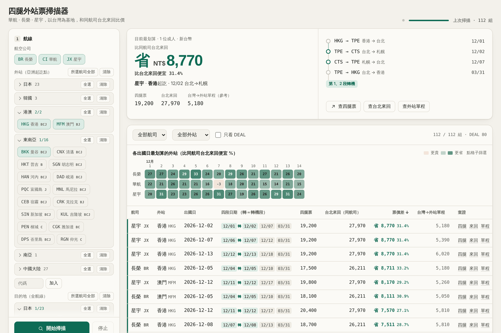

# 四腿外站票掃描器

以台灣為基地，找出**華航（CI）、長榮（BR）、星宇（JX）** 比「台北來回」更便宜的**外站四腿票**。

> 例：香港 → 台北 → 札幌 → 台北 → 香港，同一家航空、一張票。從外站出發的票價常常比台北直接買來回便宜。

由 [OO SAY HI](https://oosayhi.com) 製作，免費開源。

[](https://github.com/215Steven/fourleg-scanner/releases/latest)
[](https://github.com/215Steven/fourleg-scanner/stargazers)

**[按這裡下載最新版（fourleg-scanner.zip）](https://github.com/215Steven/fourleg-scanner/releases/latest/download/fourleg-scanner.zip)**

覺得好用的話，請幫忙按右上角的 **Star**，讓更多人找得到這個工具。

**手機、平板版（不用安裝）**：[四腿票查票連結](https://215steven.github.io/fourleg-scanner/mobile.html)，選好航線就列出每個日期的 Google Flights 查票連結，點開即可比價。



## 功能

- 一次比對多個外站、目的地、出發日期，算出「四腿票 vs. 同航司台北來回」省多少
- 內建三家航空的航點資料，自動略過航空公司沒飛的組合
- 前面轉（1、2 段轉機）或後面轉（3、4 段轉機）都可以；不轉機的那一段日期由你決定，並會在前後幾天內挑四腿最便宜的一天
- 短程線預設隔天轉機；長程線（歐洲、北美）以抵達台北的日期計算，先查當天轉機、查不到再試隔天，直飛查不到會改查同航司經停航班
- 熱度圖一眼看出哪幾天出發最划算，每筆結果都附 Google Flights 查證連結
- 「查詢紀錄」即時顯示每一次查詢的內容、結果與花費時間
- **只給查票連結（不查價）**：不送出任何查詢、不會被限流，直接列出每一組四腿票與台北來回的 Google Flights 連結，自己點開查
- 被限流停下時，還沒查的組合也會列出來（標「未查價」）並附上連結，可以手動點查
- 畫面可切換系統／淺色／深色
- 參考：同時查「台灣 → 外站」單程票價（不限航司）

### 盡量少被 Google 限流

- **每次最多查 20 組**：超過就先停，再按一次「開始掃描」會從下一組接著查
- **查過的結果保留 24 小時**，重掃不用重查
- **超過約 11 個月的航段自動略過**（Google 查不到）
- 被擋時會等一下、換一個全新的背景 Chrome 再試；一開始就連續被擋會直接停下

進階選項（快速模式、只比最便宜的幾天、兩趟合計比較、外站自動淘汰等）預設關閉，需要時可在 `config.json` 開啟。

## 安裝與使用

### Mac

1. [下載 fourleg-scanner.zip](https://github.com/215Steven/fourleg-scanner/releases/latest/download/fourleg-scanner.zip)，解壓縮
2. 雙擊 **`啟動掃描器.command`**
   - 如果跳出「無法打開」：按右鍵 → 打開 → 再按一次打開
3. 第一次會自動安裝需要的東西（約 1–2 分鐘），完成後瀏覽器會自動打開掃描器
4. 要結束時，關閉終端機視窗

沒有 Python 3.10 以上的 Mac，啟動檔會自動用 [uv](https://github.com/astral-sh/uv) 下載一份獨立的 Python，不會動到系統設定。

### Windows

1. [下載 fourleg-scanner.zip](https://github.com/215Steven/fourleg-scanner/releases/latest/download/fourleg-scanner.zip)，**先解壓縮**再開啟（不要直接在壓縮檔裡執行）
2. 雙擊 **`啟動掃描器.bat`**
   - 如果跳出「Windows 已保護您的電腦」：按 **其他資訊** → **仍要執行**
3. 第一次會自動安裝需要的東西（約 1–2 分鐘），完成後瀏覽器會自動打開掃描器
4. 要結束時，關閉黑色的命令視窗

電腦上已經有 Python 3.10 以上就直接使用；沒有的話，啟動檔會自動用 [uv](https://github.com/astral-sh/uv) 下載一份獨立的 Python，不需要自己安裝，也不會動到系統設定。

### 手動執行

```bash
pip install faster-flights typing_extensions playwright
python app.py      # 開啟 http://127.0.0.1:8765
```

## 怎麼看結果

| 欄位 | 意思 |
|---|---|
| 四腿票 | 外站起訖、經台北的四段同航司組合總價 |
| 台北來回（同航司） | 同日期、同航司的台北 ↔ 目的地來回 |
| 外站來回（同航司） | 同航司台北 ⇄ 外站來回。四腿票的頭尾兩段等於一趟外站旅行 |
| 票價差（比兩趟） | 預設「兩趟都要玩」：（台北來回＋外站來回）− 四腿票；切到「只去目的地」則是台北來回 − 四腿票 |
| 台灣→外站單程 | 參考價，不限航司，不計入票價差 |
| 經停 | 那天查不到全程直飛，改用同航司經停航班；此時台北來回也一起比經停票價 |

省超過設定比例（預設 15%）的組合會標 **DEAL**。

## 一定要知道的限制

- **價格來自 Google Flights，只是參考價。** 下單前請到航空公司官網用「多個城市」重新查詢。
- **是否允許在台灣停留、停留多久、改票規則，依各票種而定**，購票前請看清楚票價規則。
- **不要一次掃太多組合。** 短時間大量查詢會被 Google 暫時限流（查不到價格或逾時）。建議先用一家航空、一個外站、一個目的地試掃，日期每 7 天掃一次。被擋時程式會自動等待重試，連續被擋就會停止，請過一段時間再掃。
- 掃描都在你自己的電腦、用你自己的網路進行，不經過任何伺服器，也不會產生費用。
- 查價時會在背景開一個看不見的 Chrome 分頁（沒有 Chrome 會用 Edge，或第一次自動下載約 150 MB 的瀏覽器元件），連線方式跟你平常用瀏覽器查 Google Flights 一樣，比較不容易被擋。設定 `"engine": "direct"` 可改回直接連線。

## 免責聲明

本工具為個人開源專案，與 Google、中華航空、長榮航空、星宇航空無任何關係。程式透過 Google Flights 查詢公開票價，並非 Google 官方提供的 API，可能因 Google 改版而失效。請合理、少量使用，使用本工具所產生的任何結果由使用者自行負責。

## 自訂

- `config.json`：預設設定（也可以直接在網頁上改），常用進階選項：
  - `request_delay_sec`：每次查詢間隔秒數（預設 6）
  - `early_stop_after`：掃描一開始就連續幾次被擋或逾時，就判定網路被暫時封鎖並停止（預設 2）
  - `baseline_mode`：`"top"` 只比最便宜的幾個日期（預設）、`"all"` 每個日期都比
  - `baseline_top_n`：要比幾個日期（預設 5）
  - `max_combos_per_scan`：每次最多查幾組（預設 20，0 為不限）
  - `fixed_flex_days`：不轉機那一段日期的前後彈性天數（預設 1）
- `routes.json`：三家航空的航點清單，航線有變動時可以自行增刪
- 掃描結果存在 `output/`（HTML 報表與 CSV）

## 致謝

- [faster-flights](https://github.com/jamexhuang/flights)（MIT）：Google Flights 查價，包含多城市行程
- [fast-flights](https://github.com/AWeirdDev/flights)（MIT）：faster-flights 的原始專案
- [fli](https://github.com/punitarani/fli)（MIT）：Google Flights 查詢欄位格式參考；選用的月曆價功能（`baseline_calendar`）需另外 `pip install flights`

## 授權

[MIT](LICENSE)
